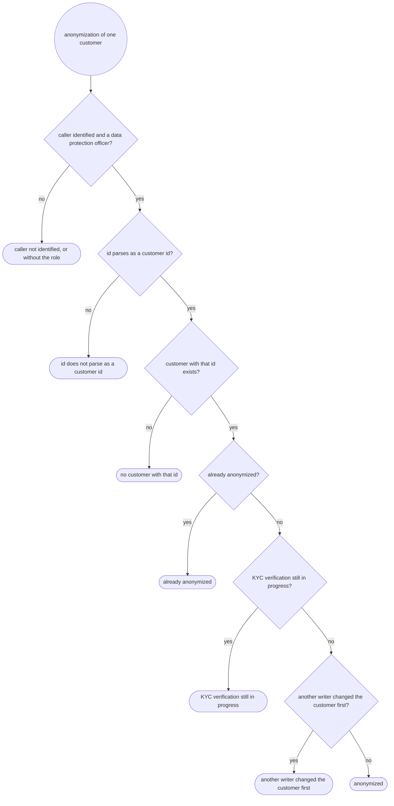
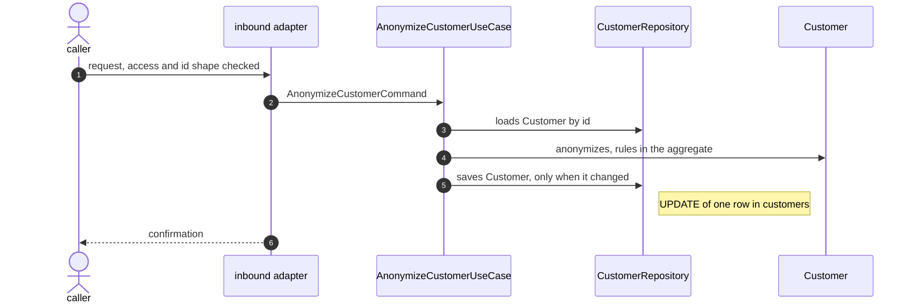

# UC-006 · Anonymize customer

> Parent spec. Fixes the boundary and the names; **doesn't** detail any layer.
> Per-layer detail lives in this folder's partials, each with its own owner.

Designed from backlog row **`BL-02`** (split from `UC-001-create-customer`, deferred by its
`20-persistencia.md`). It ends the "kept for the life of the record" retention of
`customers.security_number` and `customers.birth_date`.

| Field | Value |
|---|---|
| Identifier | `UC-006-anonymize-customer` |
| Date | 2026-10-13 |
| Trigger | anonymization of one customer by its id, over HTTP — inbound REST adapter. The request names `DELETE /api/v1/customers/{id}`; **the exact path, verb and statuses belong to `rest-api-architect`, in `30-rest.md`** |
| Access | only callers with the `DATA_PROTECTION_OFFICER` role (business fact). The request states that callers authenticate with a JWT issued by the bank's identity provider — passed on as input. Mechanism, claims-to-role mapping, annotation, 401/403 belong to `security-architect`, in `32-seguranca.md`. **First secured endpoint of the project:** no filter chain exists yet, and the endpoints of `UC-001` (creation) and `UC-003` (read) were published public — what happens to them is `security-architect`'s to record |
| Side effects | **1** — `UPDATE` of one row in `customers`: `security_number` and `birth_date` removed, `name` replaced by the fixed placeholder `ANONYMIZED`, the anonymization time stamped. The row and its `id` stay. Nothing else is written |
| External calls | none — no side effect reaches a system this service does not own |
| Publication | none — no topic, no event (request's own boundary) |
| Transaction | opens at `AnonymizeCustomerUseCase`, closes before the response |
| Repetition | anonymizing an already-anonymized customer **changes nothing** — no write, the anonymization time stays the first one — and returns **the same result** as the first call (business fact). The mechanism — state comparison, `Idempotency-Key` or none — is delegated to `rest-api-architect` |
| Concurrency | no business key can collide: the row is addressed by its primary key. A concurrent writer of the same row (a KYC verdict of `UC-005`, a second anonymization) is arbitrated by the row's existing optimistic `version`; the lock decision belongs to `domain-modeling` and `persistence-architect` |
| Freshness | none — the case only writes, and answers with a confirmation, not with data it read |
| Personal data | the response carries **none**. The request carries only the id. The case removes `security_number` and `birth_date` and the real name from `customers`; neither value is ever logged in clear — `@.claude/rules/logging.md` |
| Active blueprint | `clean-architecture` (`layout: single-module`) |

## Trigger, payload, and response

**In**

| Field | Type | Required | Rule |
|---|---|---|---|
| `id` | identifier (the customer's id, as `UC-001` returns it) | ✅ | must parse as a customer id; carried by the request itself, no body |

**Out**

Situations, not statuses. The HTTP code for each is `rest-api-architect`'s decision; the two
access rows are `security-architect`'s.

| Situation | Result |
|---|---|
| caller not identified, or without the `DATA_PROTECTION_OFFICER` role | refused before the domain |
| id does not parse as a customer id | rejected without touching the domain |
| no customer with that id | not found |
| already anonymized | the same result as `anonymized` — confirmation only, nothing written (user's answer) |
| KYC verification still in progress | business-rule violation — only a customer with a final KYC status (`ACTIVE`, `REJECTED_BY_KYC`) may be anonymized (user's answer) |
| another writer changed the customer first | conflict with existing state |
| anonymized | confirmation only, no body content about the customer (user's answer) |

## Flow

1. The inbound adapter receives the request; the caller's access and the id's **shape** are
   checked there.
2. Translates it into the command `AnonymizeCustomerCommand`.
3. `AnonymizeCustomerUseCase` loads the `Customer` through the outbound port
   `CustomerRepository`; an absent customer is not found.
4. The `Customer` aggregate anonymizes itself: an already-anonymized customer returns itself
   unchanged, a customer still in `KYC_IN_PROGRESS` is refused, any other one becomes the
   anonymized state (placeholder name, no security number, no birth date, anonymization time
   from the injected clock).
5. `CustomerRepository` saves the customer, only when its state changed.
6. The adapter answers with the confirmation.

## Components

State: **NEW** to be created · **CHANGE** already exists and changes · **REUSE**
already exists and serves. Paths relative to `src/main/java/dev/nerviz/bankapp/` unless they
start with `src/`.

| File | Layer | Role | State | Detailed by |
|---|---|---|---|---|
| `infrastructure/rest/CustomerController.java` | inbound adapter | gains the anonymization operation | CHANGE | `rest-api-architect` |
| `infrastructure/rest/CustomerApi.java` | inbound adapter | contract interface gains the operation | CHANGE | `rest-api-architect` |
| `infrastructure/rest/openapi/` — the operation's OpenAPI docs, per the existing per-operation convention | inbound adapter | OpenAPI | NEW | `rest-api-architect` |
| `infrastructure/rest/dto/CustomerDetailsResponse.java` and `infrastructure/rest/CustomerMapper.java` | inbound adapter | `UC-003`'s read: `securityNumber` and `birthDate` absent for an anonymized customer | CHANGE | `rest-api-architect` |
| `infrastructure/rest/ApiExceptionHandler.java` | inbound adapter | maps the new situation (KYC still in progress), if it needs a new mapping | CHANGE (conditional) | `rest-api-architect` |
| filter chain, JWT resource-server wiring, role mapping — location per `security-architect` | inbound adapter / configuration | access to this endpoint, and the project-wide setup | NEW | `security-architect` |
| `application/usecase/customer/AnonymizeCustomerCommand.java` | application | command | NEW | `domain-modeling` |
| `application/usecase/customer/AnonymizeCustomerUseCase.java` | application | orchestrates, opens transaction | NEW | `domain-modeling` |
| `application/port/CustomerRepository.java` | application | outbound port — `findById`, `save` | REUSE (a change, if any, is `domain-modeling`'s) | `domain-modeling` |
| `domain/model/Customer.java` | domain | aggregate — gains the anonymization and its time; `securityNumber` and `birthDate` required only while not anonymized | CHANGE | `domain-modeling` |
| `domain/model/CustomerStatus.java` | domain | closed set, unchanged values | REUSE | `domain-modeling` |
| `domain/exception/` — the "KYC still in progress" situation | domain | error | NEW or REUSE — `domain-modeling` decides | `domain-modeling` |
| `infrastructure/persistence/customer/` (entity, mapper, adapter) | outbound adapter | maps the nullable personal-data columns and the anonymization time | CHANGE | `persistence-architect` |
| `src/main/resources/db/migration/V5__…sql` | infrastructure | `security_number` and `birth_date` nullable, anonymization-time column | NEW | `persistence-architect` |

## Invariants

| Rule | Guaranteed by | Who violates it |
|---|---|---|
| a customer is anonymized exactly when it carries an anonymization time; then it has no security number, no birth date, and the name `ANONYMIZED` | `Customer` — constructor and anonymization operation | a rehydration or a transition leaving a half-anonymized state |
| a customer that is not anonymized has a security number and a birth date | `Customer`'s constructor (existing rule, now conditional) | a row with a missing value |
| only a customer with a final KYC status (`ACTIVE`, `REJECTED_BY_KYC`) may be anonymized | `Customer`'s anonymization operation | a call while KYC is still in progress |
| anonymizing twice writes nothing and keeps the first anonymization time | `Customer`'s anonymization operation (returns itself) + the use case saving only on change | a repeated call |
| the row and its `id` are kept | the case writes an update, never a delete | — |
| the name stays 2 to 120 characters | `Customer`'s constructor (existing rule); `ANONYMIZED` satisfies it | — |

Invariants live in the aggregate, never in the caller —
`@.claude/rules/architecture-ddd.md`.

## Errors

| Situation | Kind |
|---|---|
| no customer with that id | not found |
| KYC verification still in progress | business rule |
| another writer changed the customer first | conflict |
| id does not parse as a customer id | shape — rejected in the adapter, never reaches the domain |
| caller not identified, or without the role | access — `security-architect`'s, never reaches the domain |

Situations and kinds, never exception names or statuses. The exception class and
`errorCode` belong to `10-dominio.md` (`@.claude/rules/error-handling.md`); the HTTP
mapping belongs to `30-rest.md` and `32-seguranca.md`.

## Expected tests

| Level | Target | Detailed by |
|---|---|---|
| unit | `Customer`: anonymizes a final-status customer; returns itself when already anonymized; refuses `KYC_IN_PROGRESS`; rejects a half-anonymized state | `test-architect` |
| unit | use case: not found; saves only when the state changed | `test-architect` |
| slice | controller: anonymized, already anonymized (same result), not found, malformed id, KYC in progress, caller without the role, caller unidentified | `test-architect` |
| slice | `UC-003` read of an anonymized customer: no `securityNumber`, no `birthDate` | `test-architect` |
| integration | persistence adapter: anonymized row round-trip against a real database | `test-architect` |

## Out of scope for this use case

Written down so nobody merges it back in by accident:

- **Other copies of the same personal data** (user's answer — accept the existing windows):
  the KYC request payload in `outbox_events`, pruned 7 days after send (`app.outbox.prune-after:
  P7D`); the KYC request topic, 7-day retention; the external KYC application's own copy, outside
  this project. Until those windows pass, an anonymized customer's security number, birth date
  and name still exist in the outbox table and on the topic. `idempotency_keys` holds no personal
  data (`UC-001` `20-persistencia.md` § 1).
- **Re-registration** — after anonymization, the same security number may register again
  through `UC-001` as a new customer with a new id; no trace of the old number is kept (user's
  answer).
- **Who anonymized** — only the time is recorded, not the officer's identity (user's answer).
- **Deleting the row** — never; the row and its id stay.
- **Bulk or scheduled anonymization** — one customer per request.
- **A late KYC verdict** for an anonymized customer — `UC-005` applies unchanged (user's
  answer). Since only a final-status customer can be anonymized, `UC-005`'s existing rules for a
  final status (same verdict no-op, opposite verdict kept-first) already cover it.

## Impact on approved use cases

| Approved case | Change | Why | Satisfied by |
|---|---|---|---|
| `UC-001-create-customer` | `Customer` requires `securityNumber` and `birthDate` only while not anonymized, and gains an anonymization time; `customers.security_number` and `customers.birth_date` become nullable | anonymization removes both and keeps the row | — adds no precondition |
| `UC-003-get-customer` | the read of an anonymized customer returns `id`, the placeholder name, `registeredAt` and `status`, with `securityNumber` and `birthDate` absent | user's answer — the customer is still found | — adds no precondition |
| `UC-001-create-customer`, `UC-003-get-customer` | the project gains its first filter chain; their public access must survive it unchanged | this case is the first secured endpoint | — adds no precondition; `security-architect` records the `permitAll` reasons |

## Implementation order

Derived from the Components table, in compile order.

- [ ] 1. `domain/model/Customer.java` — anonymization, conditional fields
- [ ] 2. domain exception for KYC still in progress — named in `10-dominio.md`
- [ ] 3. `application/usecase/customer/AnonymizeCustomerCommand.java`
- [ ] 4. `application/usecase/customer/AnonymizeCustomerUseCase.java`
- [ ] 5. `src/main/resources/db/migration/V5__…sql`
- [ ] 6. `infrastructure/persistence/customer/` (entity, mapper, adapter)
- [ ] 7. `infrastructure/rest/` (API, controller, OpenAPI, `UC-003` read changes)
- [ ] 8. security wiring — per `32-seguranca.md`
- [ ] 9. tests for the levels above
- [ ] 10. `./mvnw clean verify` green
