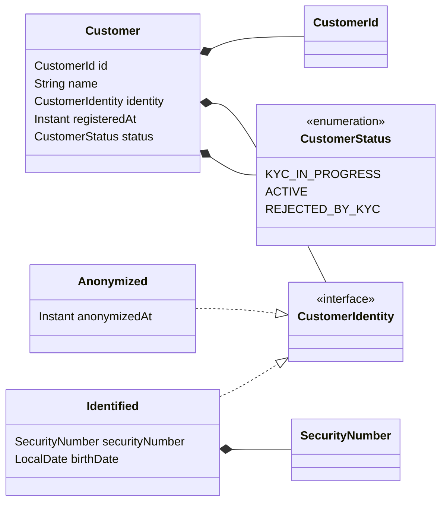
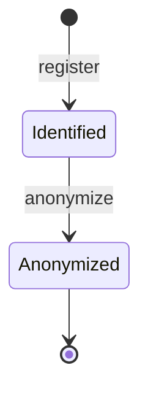

# UC-006 · Domain and application

> Partial of `docs/use-cases/UC-006-anonymize-customer/`. Owner: `domain-modeling`.
> Inherits the canonical names from `00-caso-de-uso.md` — doesn't reinvent them.
> Contains no code. Form references in
> `.claude/skills/domain-modeling/templates/*.java.example`.

| Field | Value |
|---|---|
| Mother spec | `00-caso-de-uso.md` |
| Aggregate | `Customer` (REUSE, CHANGE) |
| Divergences from the mother spec | one refinement, no contradiction: the mother spec's "anonymization time" lives inside the new sealed field `identity` (variant `Anonymized`), not as a separate field on `Customer` — see § 1. The mother spec's component table gains one row: `domain/model/CustomerIdentity.java` (NEW) |

## 1 · Aggregate and value objects

**Aggregate root:** `Customer` (REUSE — `domain/model/Customer.java`). Boundary unchanged: the
customer alone, no reference to another aggregate.

The case removes `securityNumber` and `birthDate` and keeps the row. `@.claude/rules/code-quality.md`
forbids `null` across a boundary and `Optional` on a field, so the two fields cannot simply
become absent. Decided: they move into a **sealed** field `identity`, which is either
`Identified` (holding both) or `Anonymized` (holding the anonymization time). The pair is
always present together or absent together, and the anonymization time exists exactly when
they are absent — one sealed type states the three facts with no combination left invalid.

| Field | Type | Why this type |
|---|---|---|
| `id` | `CustomerId` | REUSE — value object over `UUID` |
| `name` | `String` | REUSE — no rule of its own beyond length (2 to 120), which `Customer`'s constructor checks. Holds `ANONYMIZED` once anonymized |
| `identity` | `CustomerIdentity` | **NEW**, replaces the fields `securityNumber` and `birthDate`. Sealed: `Identified` or `Anonymized` |
| `registeredAt` | `Instant` | REUSE — unchanged |
| `status` | `CustomerStatus` | REUSE — closed set, `enum`. Unchanged values; not touched by anonymization |

**`CustomerIdentity` — sealed interface, two permitted records** (`domain/model/CustomerIdentity.java`, NEW)

| Variant | Fields | Own invariant | Factory |
|---|---|---|---|
| `CustomerIdentity.Identified` | `SecurityNumber securityNumber`, `LocalDate birthDate` | both not null — `ValidationException` `SECURITY_NUMBER_REQUIRED` / `BIRTH_DATE_REQUIRED` (the codes `Customer` raises today, moved here) | `CustomerIdentity.identified(SecurityNumber, LocalDate)` |
| `CustomerIdentity.Anonymized` | `Instant anonymizedAt` | not null — `ValidationException` `ANONYMIZED_AT_REQUIRED` | `CustomerIdentity.anonymized(Instant)` |

Both variants are nested records of the sealed interface, immutable, validated in the compact
constructor. `Identified.toString()` prints `securityNumber` through `SecurityNumber.toString()`
(already masked) and `birthDate=***`.

**`Customer` API — what changes**

| Member | State | Shape |
|---|---|---|
| `ANONYMIZED_NAME` | NEW | `public static final String ANONYMIZED_NAME = "ANONYMIZED"` — the fixed placeholder |
| record components | CHANGE | `(CustomerId id, String name, CustomerIdentity identity, Instant registeredAt, CustomerStatus status)` |
| compact constructor | CHANGE | `identity` required (`CUSTOMER_IDENTITY_REQUIRED`); when `identity` is `Anonymized`, `name` must equal `ANONYMIZED_NAME` (`CUSTOMER_ANONYMIZED_NAME_MISMATCH`) |
| `register(id, name, securityNumber, birthDate, clock)` | REUSE signature | builds `CustomerIdentity.identified(securityNumber, birthDate)`; date rules unchanged |
| `rehydrate(id, name, identity, registeredAt, status)` | CHANGE | takes the sealed `identity` instead of the two fields; the persistence mapper decides the variant from the columns |
| `recordKycVerdict(verdict)` | REUSE behaviour | carries `identity` over unchanged |
| `anonymize(Clock clock)` | **NEW** | see State reachability and invariants 3–5 |
| `isAnonymized()` | NEW | `identity instanceof CustomerIdentity.Anonymized` — for the use case's and the REST mapper's readability |
| `securityNumber()`, `birthDate()` accessors | **removed** (record components gone) | readers switch on `identity()`: `KycVerificationRequested.of`, `CustomerMapper` (REST), `CustomerPersistenceMapper` — rows in `## Impact on approved use cases` |
| `toString()` | CHANGE | `Customer[id=…, name=***, identity=…, registeredAt=…, status=…]` — `identity` prints through its own masked `toString()`; `name` masked, see Masking candidates |

**Masking candidates** — derived per `@.claude/rules/logging.md` § Masking candidates

| Field | Where | Match | Decision |
|---|---|---|---|
| `securityNumber` | `CustomerIdentity.Identified` | name (national id) | masked — `SecurityNumber.toString()` (REUSE) |
| `birthDate` | `CustomerIdentity.Identified` | name (birth) | masked — `***` in `toString()` |
| `name` | `Customer` | not on the name list; is a full name, personal data by `@.claude/rules/personal-data.md` § What counts | masked — `***` in `Customer.toString()`. Today's `toString()` prints it in clear; this case changes that (row in Impact). Proposed for the name list in the rule — the list is a floor |
| `customerId` | `AnonymizeCustomerCommand` | no match | clear — an opaque id |

No response shape in this case carries a field — confirmation only.



**State reachability**

| State field | Value | Reached by | Status |
|---|---|---|---|
| `status` | `KYC_IN_PROGRESS` | `Customer.register(...)` | approved — `UC-004` |
| `status` | `ACTIVE` | `Customer.recordKycVerdict(APPROVED)` | approved — `UC-005` |
| `status` | `REJECTED_BY_KYC` | `Customer.recordKycVerdict(REJECT)` | approved — `UC-005` |
| `identity` | `Identified` | `Customer.register(...)` | this case (the creation factory now builds it) |
| `identity` | `Anonymized` | `Customer.anonymize(clock)` — only from `ACTIVE` or `REJECTED_BY_KYC` | this case |

`identity` has no way back: `Anonymized` is final. `status` is not changed by `anonymize`, and
`recordKycVerdict` keeps working on an anonymized customer — unchanged rules for a final status
(`00-caso-de-uso.md` § Out of scope).



## 2 · Invariants

**Exception family: REUSE** — `DomainException`, `ValidationException`, `NotFoundException`,
`BusinessRuleViolationException`, `ConflictException` and `CustomerNotFoundException` exist in
`domain/exception/`. No new class: every new rule below is a new `errorCode` on the typed family.

| # | Invariant | Where it's enforced | Exception | `errorCode` |
|---|---|---|---|---|
| 1 | an `Identified` identity has a security number and a birth date | `CustomerIdentity.Identified` compact constructor | `ValidationException` | `SECURITY_NUMBER_REQUIRED` · `BIRTH_DATE_REQUIRED` (REUSE codes, moved) |
| 2 | an `Anonymized` identity has its anonymization time | `CustomerIdentity.Anonymized` compact constructor | `ValidationException` | `ANONYMIZED_AT_REQUIRED` |
| 3 | an anonymized customer is named `ANONYMIZED` | `Customer` compact constructor | `ValidationException` | `CUSTOMER_ANONYMIZED_NAME_MISMATCH` |
| 4 | only a customer with a final KYC status may be anonymized | `Customer.anonymize` | `BusinessRuleViolationException` | `CUSTOMER_KYC_IN_PROGRESS` |
| 5 | anonymizing an anonymized customer changes nothing — the first `anonymizedAt` stays | `Customer.anonymize` returns `this` when `identity` is `Anonymized`, checked **before** invariant 4 | — | — |
| 6 | the customer exists | `AnonymizeCustomerUseCase` — `findById` empty | `CustomerNotFoundException` (REUSE) | `CUSTOMER_NOT_FOUND` |
| 7 | nobody else changed the row since it was loaded | **outside the aggregate** — the row's optimistic `version`, translated by the persistence adapter | `ConflictException` (REUSE) | `CUSTOMER_CONCURRENT_UPDATE` (REUSE) |
| 8 | `identity` is present | `Customer` compact constructor | `ValidationException` | `CUSTOMER_IDENTITY_REQUIRED` |

Invariant 4 uses the plain `BusinessRuleViolationException`: first occurrence, one call site,
no caller catches it specifically — `@.claude/rules/error-handling.md` § Shape of the base
classes. Invariant 3 is a programming-error guard: only `anonymize` and the persistence mapper
build an `Anonymized` customer, and both write `ANONYMIZED_NAME`.

## 3 · Ports

**Input** — `application/usecase/customer/AnonymizeCustomerUseCase.java` (NEW). Concrete
class, no separate interface — `@.claude/rules/naming.md` § Architecture vocabulary, as
`RecordKycVerdictUseCase`.

```
class AnonymizeCustomerUseCase
    AnonymizeCustomerUseCase(CustomerRepository customerRepository, Clock clock)
    void anonymize(AnonymizeCustomerCommand command)
```

Read-write transaction opens and closes on `anonymize` (`@.claude/rules/architecture-ddd.md`
§ Application). Flow: `findById` → absent: `CustomerNotFoundException`; present:
`next = customer.anonymize(clock)`; `save(next)` only when `!next.equals(customer)` — an
already-anonymized customer writes nothing. Returns nothing: the response is a confirmation
only. Throws `CustomerNotFoundException`, `BusinessRuleViolationException`
(`CUSTOMER_KYC_IN_PROGRESS`), `ConflictException` (`CUSTOMER_CONCURRENT_UPDATE`). `Clock` is the
existing bean of `infrastructure/config/ClockConfig.java`.

**Command** — `application/usecase/customer/AnonymizeCustomerCommand.java` (NEW)

```
record AnonymizeCustomerCommand(UUID customerId)
```

JDK type at the input; the use case builds `CustomerId`. A `null` id is rejected in the compact
constructor — `ValidationException` `CUSTOMER_ID_REQUIRED`, as `GetCustomerCommand`. A
single-field record kept for symmetry with the other customer commands.

**Output** — `application/port/CustomerRepository.java` · kind `persistence` · **REUSE**,
signature unchanged

```
interface CustomerRepository
    boolean existsBySecurityNumber(SecurityNumber securityNumber)
    Customer save(Customer customer)
    Optional<Customer> findById(CustomerId id)
```

`save` now has to persist an identity change on an existing row, not only a status change —
the adapter's load-and-mutate is `persistence-architect`'s, recorded below. No new output port:
the case calls no other system and publishes nothing.

## 4 · Events

none — the mother spec fixes "no topic, no event". Anonymization emits no domain event.

## 5 · Components to create

Refines the `00-caso-de-uso.md` rows marked `Detailed by: domain-modeling`.

| File | Type | State |
|---|---|---|
| `domain/model/CustomerIdentity.java` | sealed interface + records `Identified`, `Anonymized` | NEW |
| `domain/model/Customer.java` | record aggregate — `identity`, `anonymize`, `isAnonymized`, `ANONYMIZED_NAME`, masked `toString` | CHANGE |
| `domain/model/CustomerStatus.java` | enum | REUSE |
| `domain/model/SecurityNumber.java` | record VO | REUSE |
| `domain/exception/…` | typed family + `CustomerNotFoundException` | REUSE |
| `domain/event/KycVerificationRequested.java` | record event — `of(Customer)` reads `identity` | CHANGE |
| `application/usecase/customer/AnonymizeCustomerCommand.java` | record | NEW |
| `application/usecase/customer/AnonymizeCustomerUseCase.java` | class | NEW |
| `application/port/CustomerRepository.java` | interface | REUSE |

## Design patterns

none — no force in the spec, no symptom on disk. The sealed `CustomerIdentity` is a
type-modeling choice forced by `@.claude/rules/code-quality.md` (no `null`, no `Optional`
field), not a catalog pattern; one transition (`anonymize`) and one existing one
(`recordKycVerdict`) do not meet State's "When not" (two transitions, no per-state behaviour
table beyond a guard).

## Impact on approved use cases

| Approved case | Change | Why |
|---|---|---|
| `UC-001-create-customer` | `Customer` replaces the components `securityNumber` and `birthDate` with `CustomerIdentity identity`; `register` keeps its signature and builds `Identified`; `rehydrate` takes `identity` | anonymization removes both values and keeps the row; no `null`, no `Optional` field |
| `UC-001-create-customer` | `Customer.toString()` masks `name` (`***`) | `name` is personal data (`@.claude/rules/personal-data.md` § What counts); it printed in clear |
| `UC-003-get-customer` | the REST mapper reads `identity()`: `Identified` → `securityNumber` and `birthDate` as today; `Anonymized` → both absent | user's answer — the read still finds an anonymized customer |
| `UC-004-initiate-kyc-verification` | `KycVerificationRequested.of(Customer)` reads the values from `identity()`; an `Anonymized` identity there is a programming error (`KYC_REQUEST_FIELD_REQUIRED`) — `register` always builds `Identified` | the accessors it called no longer exist |
| `UC-005-record-kyc-verdict` | none in behaviour — `recordKycVerdict` carries `identity` over unchanged | listed so nobody looks for a change |

None of these rows adds a precondition: no earlier case now requires a state it did not
require before.
