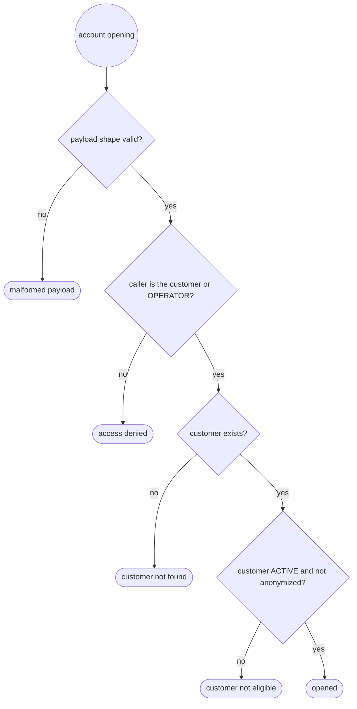
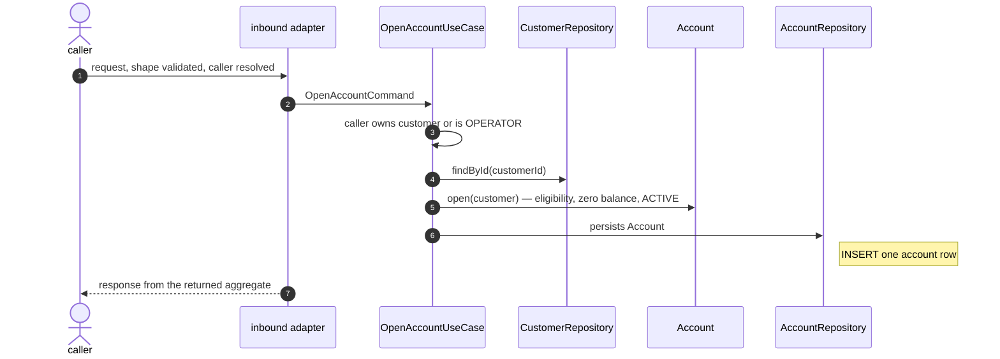

# UC-007 · Open account

> Parent spec. Fixes the boundary and the names; **doesn't** detail any layer.
> Per-layer detail lives in this folder's partials, each with its own owner.

| Field | Value |
|---|---|
| Identifier | `UC-007-open-account` |
| Date | 2026-10-30 |
| Trigger | opening of one account for one existing customer, over HTTP — inbound REST adapter. **The exact path and verb belong to `rest-api-architect`, in `30-rest.md`** |
| Access | owner — only the customer the account is opened for; a caller with the `OPERATOR` role may open it on the customer's behalf (business fact, user's answer). The caller's identity has to resolve to a `CustomerId`: which claim carries it, the mechanism, annotation and 401/403 belong to `security-architect`, in `32-security.md`. The actor field and the ownership invariant are `domain-modeling`'s |
| Side effects | **1** — `INSERT` of one account row. The customer is read, never written |
| Storage | `Account` → relational; `Customer` → relational (REUSE) — chosen by: request (the account belongs to a `Customer` already stored in the `customers` table; the project has one relational store). Tables and the engine belong to `persistence-architect`, in `20-persistence.md` |
| Search index | none |
| Audit | none — the request asks nothing about who changed the data |
| Admission | none — the request states no limit |
| External calls | none — no side effect reaches a system this service does not own |
| Publication | none — no topic, no event |
| Transaction | opens at `OpenAccountUseCase`, closes before the response |
| Repetition | two facts. Retry safety: a client that lost the response may send the same request again with no second account (`@.claude/rules/api-rest.md` § Idempotency — a creating `POST` keeps the `Idempotency-Key`; mechanism is `rest-api-architect`'s). Domain uniqueness: a customer **may** hold many accounts — two different requests open two accounts (user's answer) |
| Concurrency | no business key can collide: the account id is generated, and many accounts per customer are allowed. A concurrent change of the customer's status (a verdict of `UC-005`, an anonymization of `UC-006`) is read at its committed value; the lock decision belongs to `domain-modeling` and `persistence-architect` |
| Freshness | none — the case returns what it just wrote |
| Personal data | the response carries the account id, its owner's customer id, balance and status — no field of `@.claude/rules/logging.md` § Masking candidates |
| Active blueprint | `clean-architecture` (`layout: single-module`) |

## Trigger, payload, and response

**In**

| Field | Type | Required | Rule |
|---|---|---|---|
| `customerId` | identifier | ✅ | an existing customer; the caller owns it, or holds `OPERATOR` |

Where `customerId` travels (path or body) is `rest-api-architect`'s decision.

**Out**

| Situation | Result |
|---|---|
| opened | reference to the created account + account `id`, `customerId`, `balance` (USD 0.00), `status` (`ACTIVE`) |
| malformed payload | rejected without touching the domain |
| customer not found | not found |
| caller is neither the customer nor an `OPERATOR` | access denied — `security-architect`'s |
| customer not `ACTIVE` (KYC pending or rejected) or anonymized | business rule violated — no account opened |

## Flow

1. The inbound adapter receives the request, validates the payload's **shape**, and resolves the caller.
2. Translates it into the command `OpenAccountCommand` (customer id, caller).
3. `OpenAccountUseCase` checks the caller owns the customer or holds `OPERATOR`.
4. The outbound port `CustomerRepository` loads the `Customer`; absent → not found.
5. `Account.open(customer)` builds the aggregate: rejects a customer not `ACTIVE` or anonymized, starts at balance USD 0.00, status `ACTIVE`.
6. The outbound port `AccountRepository` persists it.
7. The adapter translates the returned aggregate into the response.

## Components

| File | Layer | Role | State | Detailed by |
|---|---|---|---|---|
| `infrastructure/rest/AccountController.java` | inbound adapter | receives HTTP | NEW | `rest-api-architect` |
| `infrastructure/rest/AccountApi.java` | inbound adapter | OpenAPI contract interface | NEW | `rest-api-architect` |
| `infrastructure/rest/dto/OpenAccountRequest.java` | inbound adapter | input DTO | NEW | `rest-api-architect` |
| `infrastructure/rest/dto/AccountResponse.java` | inbound adapter | output DTO | NEW | `rest-api-architect` |
| `infrastructure/rest/AccountMapper.java` | inbound adapter | DTO ↔ domain | NEW | `rest-api-architect` |
| `infrastructure/rest/openapi/OpenAccountOpenApiDocs.java` | inbound adapter | OpenAPI docs | NEW | `rest-api-architect` |
| `infrastructure/config/security/SecurityConfig.java` | infrastructure | access rule for the new endpoint, actor resolution | CHANGE | `security-architect` |
| `application/usecase/account/OpenAccountCommand.java` | application | command | NEW | `domain-modeling` |
| `application/usecase/account/OpenAccountUseCase.java` | application | orchestrates, opens transaction | NEW | `domain-modeling` |
| `application/port/AccountRepository.java` | application | outbound port | NEW | `domain-modeling` |
| `application/port/CustomerRepository.java` | application | outbound port — `findById` | REUSE | — |
| `domain/model/Account.java` | domain | aggregate | NEW | `domain-modeling` |
| `domain/model/AccountId.java` | domain | typed id | NEW | `domain-modeling` |
| `domain/model/AccountStatus.java` | domain | typed field for `status`, closed set (`ACTIVE`, `INACTIVE`) — shape is `domain-modeling`'s | NEW | `domain-modeling` |
| `domain/model/Money.java` | domain | typed field for `balance`, single currency USD, two decimals — shape is `domain-modeling`'s | NEW | `domain-modeling` |
| `domain/model/Customer.java` | domain | aggregate — status and anonymization read | REUSE | — |
| `infrastructure/persistence/account/AccountEntity.java` | outbound adapter | persistence entity | NEW | `persistence-architect` |
| `infrastructure/persistence/account/AccountJpaRepository.java` | outbound adapter | Spring Data interface | NEW | `persistence-architect` |
| `infrastructure/persistence/account/AccountRepositoryJpaAdapter.java` | outbound adapter | implements the port | NEW | `persistence-architect` |
| `infrastructure/persistence/account/AccountPersistenceMapper.java` | outbound adapter | entity ↔ domain | NEW | `persistence-architect` |
| `src/main/resources/db/migration/V6__create_accounts.sql` | infrastructure | migration | NEW | `persistence-architect` |

Paths under `src/main/java/dev/nerviz/bankapp/`, derived from the packages already on disk.

## Invariants

| Rule | Guaranteed by | Who violates it |
|---|---|---|
| an account belongs to exactly one existing customer | `Account.open` + foreign key | caller with an unknown customer id |
| only an `ACTIVE`, non-anonymized customer gets an account | `Account.open` | customer with KYC pending or rejected, anonymized customer |
| a new account starts at balance USD 0.00, status `ACTIVE` | `Account.open` | — |
| balance is never negative | `Account` | (future debit — BL-06) |
| only the customer or an `OPERATOR` opens the account | use case + `security-architect` | another customer |

## Errors

| Situation | Kind |
|---|---|
| customer not found | not found |
| customer not `ACTIVE` or anonymized | business rule |
| caller neither the customer nor `OPERATOR` | access — `security-architect`'s |
| required field missing or malformed id | shape — rejected in the adapter, never reaches the domain |

## Expected tests

| Level | Target | Detailed by |
|---|---|---|
| unit | `Account.open`: zero balance, `ACTIVE`; rejects non-`ACTIVE` and anonymized customer | `test-architect` |
| unit | use case: not found, ownership check, `OPERATOR` override | `test-architect` |
| slice | controller: opened, malformed payload, not found, not eligible | `test-architect` |
| integration | `AccountRepositoryJpaAdapter` against a real database; access rules end to end | `test-architect` |

## Out of scope for this use case

- Transfer between two accounts → **`BL-06`**. Split from this request; needs the `Account` this case creates.
- Deposit into an account → **`BL-07`**. Until it ships, every account holds USD 0.00 and no transfer can succeed.
- Deactivate an account → **`BL-08`**. Until it ships, no production path makes an account `INACTIVE`.
- Listing and reading accounts → their own use cases.

## Impact on approved use cases

none — no approved case changes. `Customer` and `CustomerRepository` are read as they are.

## Implementation order

- [ ] 1. `domain/model/AccountId.java`, `Money.java`, `AccountStatus.java`
- [ ] 2. `domain/model/Account.java`
- [ ] 3. domain exceptions — named in `10-domain.md`
- [ ] 4. `application/usecase/account/OpenAccountCommand.java`
- [ ] 5. `application/port/AccountRepository.java`
- [ ] 6. `application/usecase/account/OpenAccountUseCase.java`
- [ ] 7. `db/migration/V6__create_accounts.sql`
- [ ] 8. `infrastructure/persistence/account/` (entity, Spring Data, mapper, adapter)
- [ ] 9. `infrastructure/rest/` (DTOs, mapper, API, controller, OpenAPI docs)
- [ ] 10. security rule and actor resolution
- [ ] 11. tests for the levels above
- [ ] 12. `./mvnw clean verify` green
