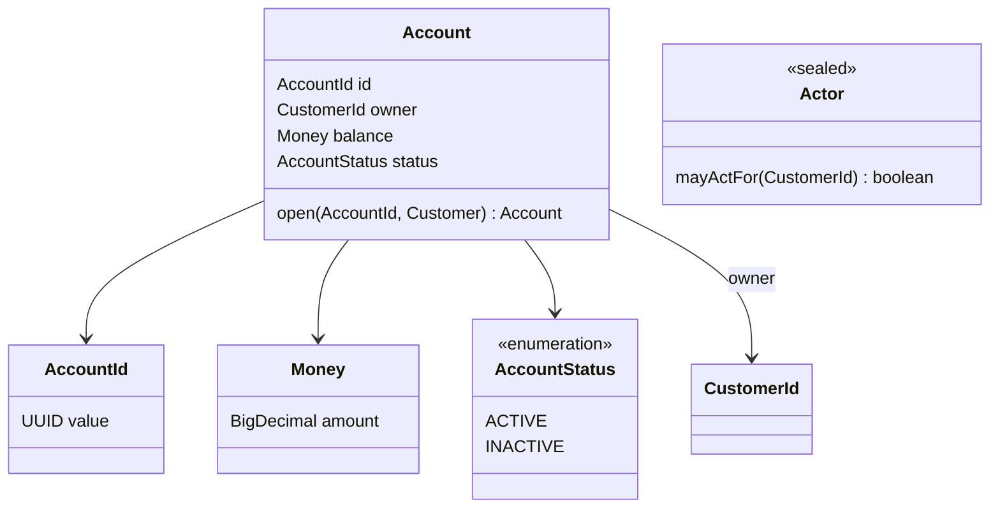
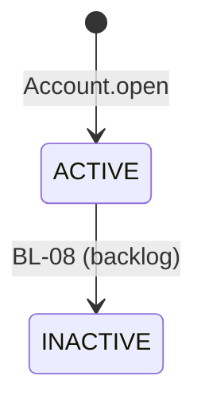

# UC-007 · Domain and application

> Partial of `00-use-case.md`. Owner: `domain-modeling`. Package root
> `dev.nerviz.bankapp` (clean-architecture, single-module).

## 1 · Aggregate and value objects

**`Account`** (NEW) — `domain/model/Account.java`, a record, no framework.

| Field | Type | Why |
|---|---|---|
| `id` | `AccountId` | identity; UUIDv7 generated in the use case, as `CreateCustomerUseCase` does for `CustomerId` (`Generators.timeBasedEpochGenerator()`) |
| `owner` | `CustomerId` (REUSE) | reference by id to the owning `Customer` — never the `Customer` itself (separate aggregate, separate lock) |
| `balance` | `Money` | amount in the single currency (USD) |
| `status` | `AccountStatus` | lifecycle |

Factories: `static Account open(AccountId id, Customer owner)` — the only creation path; `static Account rehydrate(AccountId, CustomerId, Money, AccountStatus)` — persistence only, never a transition.

**Value objects and enums**

| Type | State | Shape | Rule |
|---|---|---|---|
| `AccountId` | NEW | record over `UUID`, `of(UUID)` | required — `ACCOUNT_ID_REQUIRED`; same form as `CustomerId` |
| `Money` | NEW | record over `BigDecimal`, scale 2, `of(BigDecimal)`, `zero()` | value object by `@.claude/rules/value-objects.md` criterion 1 (formation rule): required, non-negative, at most 2 decimals — `MONEY_REQUIRED`, `MONEY_NEGATIVE`, `MONEY_SCALE_INVALID`. Currency is implicit USD (single-currency, user's answer) — no currency field; a second currency is a future case's change |
| `AccountStatus` | NEW | `enum` (`ACTIVE`, `INACTIVE`) — closed set, no formation rule, criterion 3 | `boolean acceptsMovements()` — `true` only for `ACTIVE`; the transfer (`BL-06`) asks it |
| `Actor` | NEW | sealed interface `Actor permits Actor.Customer, Actor.Operator`; `Actor.Customer(CustomerId id)`, `Actor.Operator()` | `boolean mayActFor(CustomerId owner)`: a customer actor only for itself, an operator for anyone |

**Change to `Customer`** (CHANGE, REUSE of everything else): adds the query
`boolean canHoldAccount()` — `status == ACTIVE && !isAnonymized()`. It reads the existing
state only; no field, no transition.

**State reachability** — `AccountStatus`:

| Value | Reached by |
|---|---|
| `ACTIVE` | `Account.open` (this case) |
| `INACTIVE` | `BL-08` (deactivate account), backlog — no method designed here; until it ships, no production path produces it |

**Masking candidates** (`@.claude/rules/logging.md` § Masking candidates): none. `Account`,
`OpenAccountCommand` and `Actor` hold ids, an amount and a status — no field matches by type
or by name. `balance` is financial, not personal data; logged in clear.





## 2 · Invariants

Exception family: **REUSE** — `DomainException`, `ValidationException`, `NotFoundException`,
`ConflictException`, `BusinessRuleViolationException`, `ConcurrentUpdateException`, and the
named `CustomerNotFoundException` already exist in `domain/exception`. No new class.

| Rule | Enforced in | Exception | `errorCode` |
|---|---|---|---|
| account id present | `AccountId` constructor | `ValidationException` | `ACCOUNT_ID_REQUIRED` |
| amount present | `Money` constructor | `ValidationException` | `MONEY_REQUIRED` |
| amount non-negative | `Money` constructor | `ValidationException` | `MONEY_NEGATIVE` |
| amount has at most 2 decimals | `Money` constructor | `ValidationException` | `MONEY_SCALE_INVALID` |
| the customer exists | `OpenAccountUseCase` | `CustomerNotFoundException` (REUSE) | `CUSTOMER_NOT_FOUND` |
| the actor is the customer or an operator | `OpenAccountUseCase`, via `Actor.mayActFor` | `CustomerNotFoundException` (REUSE) — same as absent, so a response never reveals another customer exists (`@.claude/rules/authorization.md` § Boundary) | `CUSTOMER_NOT_FOUND` |
| only an `ACTIVE`, non-anonymized customer holds an account | `Account.open`, via `Customer.canHoldAccount()` | `BusinessRuleViolationException` | `CUSTOMER_NOT_ELIGIBLE_FOR_ACCOUNT` |
| a new account starts at `Money.zero()`, `ACTIVE` | `Account.open` | — (construction) | — |

`CUSTOMER_NOT_ELIGIBLE_FOR_ACCOUNT` is a first occurrence: plain family, no subclass.

## 3 · Ports

**Input** — `application/usecase/account/OpenAccountUseCase.java` (concrete class, no interface):

```java
/** @throws CustomerNotFoundException CUSTOMER_NOT_FOUND — absent, or not the actor's
 *  @throws BusinessRuleViolationException CUSTOMER_NOT_ELIGIBLE_FOR_ACCOUNT */
@Transactional
public Account open(OpenAccountCommand command)
```

**Command** — `application/usecase/account/OpenAccountCommand.java`:
`record OpenAccountCommand(UUID customerId, Actor actor)` — both required. The controller builds
`Actor` from the authenticated principal; where it reads it is `security-architect`'s.

**Output**

| Port | Kind | Signature | State |
|---|---|---|---|
| `CustomerRepository` | persistence | `Optional<Customer> findById(CustomerId id)` | REUSE |
| `AccountRepository` | persistence | `Account save(Account account)` | NEW — `application/port/AccountRepository.java` |

Flow: `findById` → absent or `!actor.mayActFor(id)` → `CustomerNotFoundException` →
`Account.open(AccountId.of(uuidv7), customer)` → `save`.

## 4 · Events

none — the case publishes nothing (`00-use-case.md` § Publication).

## 5 · Components to create

| File | State |
|---|---|
| `domain/model/Account.java` | NEW |
| `domain/model/AccountId.java` | NEW |
| `domain/model/Money.java` | NEW |
| `domain/model/AccountStatus.java` | NEW |
| `domain/model/Actor.java` | NEW |
| `domain/model/Customer.java` | CHANGE — `canHoldAccount()` |
| `application/usecase/account/OpenAccountCommand.java` | NEW |
| `application/usecase/account/OpenAccountUseCase.java` | NEW |
| `application/port/AccountRepository.java` | NEW |

## Design patterns

| Pattern | Force | Classes | When not — checked |
|---|---|---|---|
| none | — | — | the case adds one factory with one rule and one predicate; no rule varies per type, no chain grows (`gof-design-patterns` § Design-time use) |

## Impact on approved use cases

| Approved case | Change | Why | Satisfied by |
|---|---|---|---|
| `UC-001-create-customer` | `Customer` gains the read-only query `canHoldAccount()` | this case asks eligibility of the aggregate, not of the caller | — (no precondition added to UC-001) |

## Divergences with `00-use-case.md`

| Fact | `00-use-case.md` | This partial | Why |
|---|---|---|---|
| caller neither the customer nor `OPERATOR` | "access denied" situation | answered as **customer not found** (`CUSTOMER_NOT_FOUND`) | `@.claude/rules/authorization.md` § Boundary — ownership is a business rule and must not reveal another's resource; a caller with no role at all is still the filter chain's 401/403 |
| `Customer.java` | REUSE | CHANGE — adds `canHoldAccount()` | eligibility belongs to the customer's own state |
